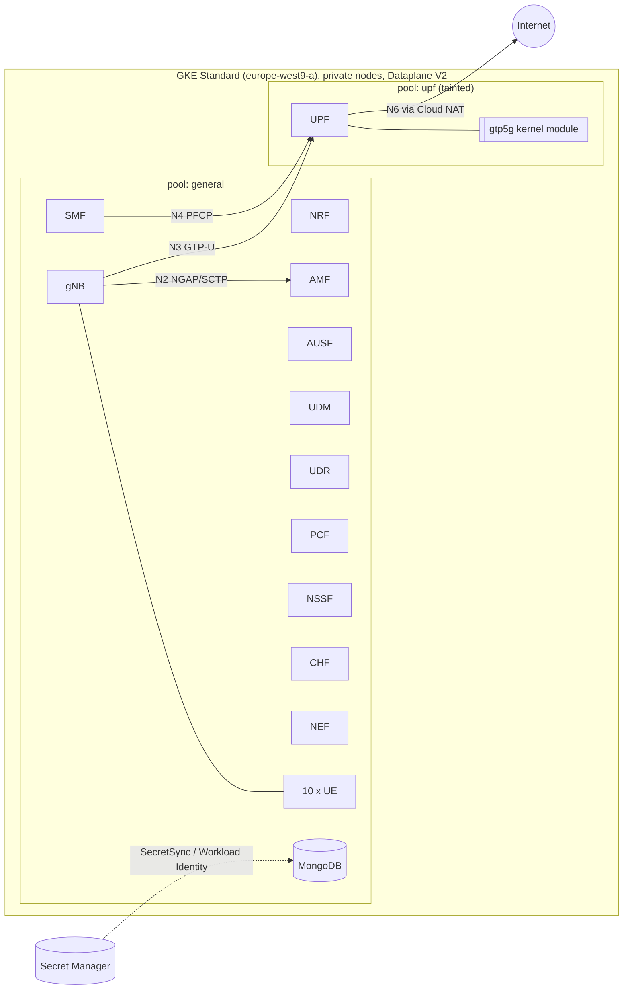

# free5GC + UERANSIM on GKE with Terraform

A reproducible, security-conscious template that deploys a **5G Standalone
core** ([free5GC](https://free5gc.org) v4.2.2) and a **simulated RAN with 10
UEs** ([UERANSIM](https://github.com/aligungr/UERANSIM)) on **Google Kubernetes
Engine**, using Terraform and the official free5GC Helm charts.

> **Status (2026-10-13).** Deployed and verified end to end on GKE 1.36.4
> (Ubuntu 24.04.4, kernel 6.8.0-1062-gke, `europe-west1`): gtp5g 0.10.2 built
> and loaded on the node, all NFs Ready, 10/10 subscribers provisioned, gNB NG
> Setup over SCTP, 10/10 UEs registered, 10/10 PDU sessions, and 10/10 UEs
> pinging 8.8.8.8 through the UPF. 16/16 `verify.sh` checks passed. All static
> and local tests also pass. Details and the bugs the live run exposed:
> [docs/testing.md](docs/testing.md).
>
> This is a lab template, not a production 5G core.

## What you get

- **GCP**: dedicated VPC with explicit Node/Pod/Service ranges, private nodes,
  Cloud NAT, a GKE Standard zonal cluster (Dataplane V2, Workload Identity,
  Shielded nodes, KMS-encrypted Secrets, no public control-plane IP), a
  least-privilege node service account, and a Docker Hub pull-through cache.
- **5G core**: one AMF, SMF and UPF, plus NRF, AUSF, UDM, UDR, PCF, NSSF, CHF
  and NEF; MongoDB with authentication on a Persistent Disk.
- **RAN**: one UERANSIM gNB and 10 UEs, each with its own random K/OPc.
- **Subscribers**: 10 IMSIs derived from `config/subscribers.yaml`, provisioned
  idempotently by a Kubernetes Job.
- **Secrets**: generated outside Terraform, stored in Secret Manager, delivered
  by GKE Secret Manager sync. None in Git, Terraform state, Helm values or logs.
- **Checks**: `scripts/validate.sh` (offline), `scripts/verify.sh` (health and
  5G functional tests, with saved evidence), and CI on every PR.

## Architecture



Details: [architecture](docs/architecture.md) · [networking](docs/networking.md)
· [security](docs/security.md) · [deployment](docs/deployment.md) ·
[testing](docs/testing.md) · [troubleshooting](docs/troubleshooting.md)

## Quick start

```bash
# 0. Prerequisites: terraform >= 1.9, gcloud (+ gke-gcloud-auth-plugin), kubectl,
#    git, openssl; a GCP project with billing; IAM per docs/deployment.md#iam.
gcloud auth application-default login

# 1. Configure
cp terraform/infra/terraform.tfvars.example terraform/infra/terraform.tfvars
$EDITOR terraform/infra/terraform.tfvars                  # project_id
$EDITOR config/network.yaml config/subscribers.yaml        # optional

# 2. Validate offline (no cloud access; needs helm + python3)
scripts/validate.sh

# 3. Deploy (shows each Terraform plan and asks "yes" before billable changes)
scripts/deploy.sh

# 4. Verify (health + registration, PDU sessions, ping through the UPF)
scripts/verify.sh

# 5. Tear down
scripts/destroy.sh
```

Deployment is **two Terraform stages** (`terraform/infra`, then
`terraform/platform`) with a secrets bootstrap in between, because the
Kubernetes/Helm providers need an existing cluster. `deploy.sh` wires them
together; see [deployment.md](docs/deployment.md) for the manual steps.

## Configuration

**IP ranges** (`config/network.yaml`): illustrative defaults, all
configurable, validated before anything is created (canonical CIDR, private
space, no overlap, GKE capacity per node pool).

```yaml
gcp:
  node_cidr: "10.10.0.0/24"     # nodes
  pod_cidr: "10.20.0.0/20"      # Pods (GKE secondary range)
  service_cidr: "10.30.0.0/20"  # Services (GKE secondary range)
  max_pods_per_node: 64
free5gc:
  ue_cidr: "10.60.0.0/16"       # UE PDU sessions; not a Kubernetes range
  dnn: "internet"
```

**Subscribers** (`config/subscribers.yaml`): IMSIs are generated by
incrementing the MSIN after `mcc`+`mnc`, keeping leading zeros.

```yaml
subscribers:
  count: 10
  mcc: "208"
  mnc: "93"
  starting_imsi: "208930000000001"   # -> 208930000000001 ... 208930000000010
  dnn: "internet"
  sst: 1
  sd: "010203"
```

K and OPc are **not** configured anywhere: `scripts/bootstrap-secrets.sh`
generates a random pair per IMSI into Secret Manager.

**Infrastructure** (`terraform/infra/terraform.tfvars`): project, region (default
`europe-west9`), zone, node pool machine types and counts, Spot, logging scope,
KMS encryption, registry proxy. See `variables.tf`.

## Costs

About **$190-210 per month (about $0.27/hour)** running continuously with the
defaults (1 × e2-standard-4 + 1 × e2-standard-2 in Paris, disks, NAT), plus the
GKE management fee of $0.10/h if your billing account's GKE free tier is already
used. A 4-hour session costs about $1-1.50. Destroy when idle; Spot nodes halve
compute cost. Itemised estimate and sources: [deployment.md](docs/deployment.md#5-costs-estimates-2026-10-13-europe-west9-on-demand-730-hmonth).

## Security in brief

- Terraform uses **Application Default Credentials**; CI uses **GitHub OIDC +
  Workload Identity Federation**. No service-account key exists.
- Secret values are generated outside Terraform and never enter plans or
  state. Marking variables `sensitive` would not achieve that.
- Private nodes, no public control-plane IP endpoint (IAM-authorised DNS
  endpoint), no NodePort/LoadBalancer/Ingress, default-deny NetworkPolicies,
  least-privilege IAM, MongoDB authentication, KMS-encrypted Kubernetes
  Secrets, every image pinned by digest.
- Upstream insecure defaults replaced: WebConsole default admin (not deployed),
  NEA0-only NAS ciphering, unauthenticated MongoDB, default UE keys,
  root `apt-get` at MongoDB start.
- **Residual risks** (privileged UPF components, a UPF pool without Secure Boot,
  Kubernetes Secrets readable by cluster admins, plain-HTTP SBI, upstream test
  keys, lab-grade NFs): [security.md](docs/security.md#7-residual-risks-accepted-for-a-lab).

## Repository layout

```text
config/              network.yaml, subscribers.yaml, versions.yaml (all pins)
terraform/
  infra/             stage 1: network, gke, iam, registry, secrets modules
  platform/          stage 2: namespaces, SecretSync, gtp5g, Helm releases, Job, NetworkPolicies
  modules/config     pure validation + derivation (unit-tested with `terraform test`)
  modules/render     pure Helm values rendering (shared by platform and validate.sh)
helm/                values templates (*.tftpl) and patches/ for the upstream charts
kubernetes/gtp5g/    node-side gtp5g build-and-load script
provisioning/        subscriber provisioner (mongosh)
scripts/             validate, fetch-charts, bootstrap-secrets, deploy, verify, destroy
tests/               render harness, manifest checks, IMSI and provisioner tests
docs/                architecture, networking, security, deployment, testing, troubleshooting, article draft
```

Changes from the suggested layout: two root modules instead of one (see
architecture D1), two provider-less modules (`config`, `render`) so validation
and rendering are testable offline, `kubernetes/` for the node script, and
`docs/testing.md`.

## Versions

free5GC v4.2.2 (charts at commit `0d0b4b3`), go-upf v1.2.10, gtp5g 0.10.2,
UERANSIM image v4.0.1, MongoDB 7.0.9, GKE REGULAR channel (>= 1.33, Ubuntu
24.04 nodes), google provider 8.4, kubernetes provider 3.2, helm provider 3.3.
Full matrix and compatibility evidence: [architecture.md](docs/architecture.md#2-version-matrix).

## Licence

Apache-2.0 (same as the upstream charts). free5GC, UERANSIM and gtp5g are
separate projects under their own licences.
