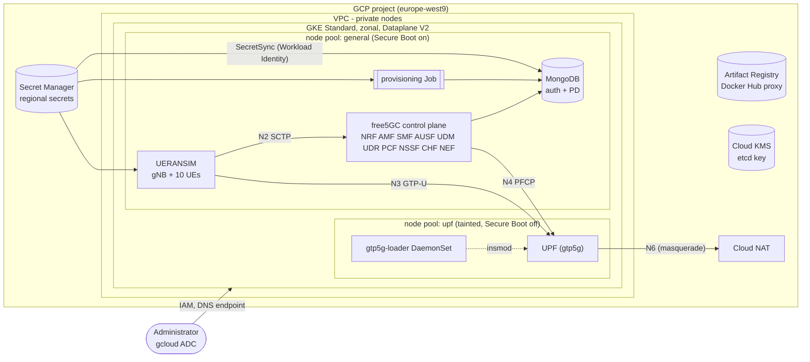
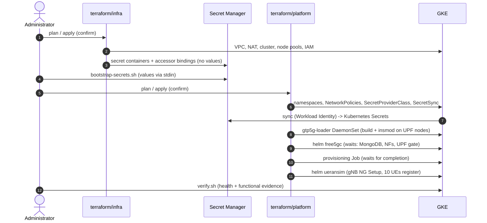

# Architecture

This document records the research behind the design, the pinned versions,
and every architectural decision with its rationale. Sources were inspected on
2026-10-13; links point to the exact upstream files.

## 1. Research findings

### Upstream charts

| Question | Finding | Evidence |
|---|---|---|
| Official chart location | [`free5gc/free5gc-helm`](https://github.com/free5gc/free5gc-helm), charts `charts/free5gc` (1.1.7) and `charts/ueransim` (2.0.17) | `Chart.yaml` at tag `v4.2.2` |
| Pinned release | Tag `v4.2.2` = commit `0d0b4b3`. `main` is ahead (CI changes, an untagged bump to v4.3.0); not used | `git log v4.2.2..origin/main` |
| Application versions | Every NF image is `free5gc/<nf>:v4.2.2`; UERANSIM image `free5gc/ueransim:v4.0.1`; MongoDB `bitnamilegacy/mongodb:7.0.9-debian-12-r4` (bundled `mongodb-15.6.0` chart) | per-NF `values.yaml` |
| Single UPF without editing chart sources? | **No.** `global.userPlaneArchitecture: single` exists, but in non-Multus mode the SMF wrapper only resolves the ULCL UPF Services. The upstream README says to *replace* `templates/smf-configmap.yaml` with the shipped `smf-configmap-single-upf.yaml` | chart README, "Enable the single UPF feature" |
| MongoDB authentication via values? | **Half.** The Bitnami subchart supports `auth.existingSecret`, but NRF/UDR/PCF/CHF build `mongodb://host:port` with no credential field | `*-configmap.yaml`, `*-deployment.yaml` |
| Bulk provisioning with DBPython? | **Not suitable.** `free5gc-dbpython` is a Deployment of an unpinned third-party image (`towards5gs/free5gc-dbpython`, no tag) whose container runs `sleep infinity`; disabled by default | `free5gc-dbpython/templates/dbpython-deployment.yaml` |
| WebConsole | Optional subchart; creates a default `admin`/`free5gc` login | webconsole backend |
| Unsafe defaults found | AMF `cipheringOrder: [NEA0]` (no NAS ciphering); MongoDB `auth.enabled: false`; WebConsole default admin; MongoDB init container `apt-get install tini` from unpinned `debian:12-slim` as root on every start; a microk8s `local` PersistentVolume pinned to a host named `free5gc`; `towards5gs/sctp_test:latest`; the umbrella chart ships TLS **private keys** (`cert/*.key`) as Secrets; UDM SUCI keys are the public TS 33.501 Annex C.4 test vectors | values files, `templates/nf-secrets.yaml` |

### gtp5g and the UPF

| Question | Finding |
|---|---|
| UPF version in free5GC v4.2.2 | go-upf **v1.2.10** (free5GC submodule commit `04c1ab6`) |
| Required gtp5g range | go-upf README table: `>= 0.9.3 and < 0.10.3`. Check compiled into v1.2.10: `0.9.5 <= v < 0.11.0`. **Intersection: `0.9.5 <= v < 0.10.3`** |
| Pinned gtp5g | **v0.10.2** (commit `952fb41`, 2026-03-04). Source tarball SHA-256 `8fa39a54…5123` |
| Kernel support | gtp5g README: kernels from 5.4 upward. Explicit guards for 6.18 and 7.0 were added on `main` *after* 0.10.2, so kernels >= 6.18 may need a newer gtp5g (and a UPF that accepts it) |
| Node OS on GKE | Container-Optimized OS enables LoadPin and blocks out-of-tree modules ([GKE docs](https://docs.cloud.google.com/kubernetes-engine/security/secure-modules-cos)). **Ubuntu** node images have no such restriction documented; Ubuntu publishes `linux-headers-*-gke` packages for its GKE kernels, and the Kubernetes KMM project documents Ubuntu GKE nodes as the workable path |
| Secure Boot | The Ubuntu kernel enforces module signatures under Secure Boot (lockdown). gtp5g is unsigned, so Secure Boot must be off **on the nodes that load it** |
| Is a privileged DaemonSet enough? | Plausible, **not yet proven on GKE**. See §4 and the validation gate |

### GKE

| Question | Finding |
|---|---|
| SCTP (N2/NGAP) | Requires **GKE Dataplane V2 + Ubuntu nodes + GKE >= 1.32.2-gke.1297000**; SCTP Service `port` must equal `targetPort` ([GKE docs](https://docs.cloud.google.com/kubernetes-engine/docs/how-to/deploy-workloads-with-sctp)) |
| Secret delivery | GKE Secret Manager add-on + **Secret Manager sync to Kubernetes Secrets** (`SecretSync`, GKE >= 1.33); regional secrets in the cluster's region; Workload Identity principal binding, no Google service account needed |
| Ubuntu image | `UBUNTU_CONTAINERD`, Ubuntu 24.04 (default since GKE 1.32.1) |
| Unsafe sysctl for UPF | The UPF chart sets `net.ipv4.ip_forward` as a Pod sysctl; allowed per node pool with `kubelet_config.allowed_unsafe_sysctls` (google provider 8.x) |
| Private control plane | DNS-based endpoint with IAM authorisation; public IP endpoint disabled |

## 2. Version matrix

All pins live in `config/versions.yaml`, `scripts/lib/pins.sh` and the
`required_providers` blocks (with `.terraform.lock.hcl`).

| Component | Version | Pin |
|---|---|---|
| free5GC NFs | v4.2.2 | image digest |
| go-upf (in UPF image) | v1.2.10 | image digest |
| gtp5g | 0.10.2 | tarball SHA-256 |
| free5gc-helm | v4.2.2 / `0d0b4b3` | commit verified at fetch |
| UERANSIM image | free5gc/ueransim v4.0.1 | image digest |
| MongoDB | 7.0.9 (Bitnami legacy image, chart 15.6.0) | image digest |
| GKE | release channel REGULAR, minor >= 1.33 enforced by a plan-time precondition | — |
| Node image | UBUNTU_CONTAINERD (Ubuntu 24.04) | builder image `ubuntu:24.04@sha256:534b…eb55` |
| Terraform | >= 1.9 (tested 1.16.5) | — |
| google provider | 8.4.x | lock file |
| kubernetes provider | 3.2.x | lock file |
| helm provider | 3.3.x | lock file |
| Helm CLI (validation) | v3.21.4 | CI |

## 3. Component view

## 4. Decisions

**D1. Two Terraform root modules (infra, platform).** The Kubernetes and Helm
providers need a reachable cluster at plan time and during destroy. One root
would mean the cluster and its providers are created in the same run, a known
source of `-target` workarounds and failed destroys. Splitting gives each stage
a clean lifecycle; `scripts/deploy.sh` passes infra outputs to platform as
`TF_VAR_*`. There are no cycles: platform reads infra outputs, never the
reverse.

**D2. Pure `config` and `render` modules.** All validation (CIDRs, IMSIs,
PLMN encodings, image pins) and all Helm values rendering live in modules
without providers. Both stages share them, and they run offline in
`terraform test` and in `scripts/validate.sh`, which renders the *exact*
values the platform stage deploys and feeds them to `helm template`.

**D3. Official charts + minimal reproducible patches.** Values first; patches
only where §1 shows values cannot work. See [`helm/patches/README.md`](../helm/patches/README.md).

**D4. Single UPF, no Multus.** All interfaces ride the Pod network (see
[networking.md](networking.md)). Multus with ipvlan/macvlan is not supported on
GKE Dataplane V2 out of the box and is not needed for a functional lab.

**D5. Dedicated UPF node pool.** It does materially improve reproducibility and
security: the Secure Boot exception, the `ip_forward` unsafe-sysctl allowance
and the privileged module loader are confined to one tainted pool, while the
general pool keeps Secure Boot on. Node replacement re-runs the loader
automatically (DaemonSet).

**D6. gtp5g built on the node, gated twice.**
1. `gtp5g-loader` (DaemonSet, UPF pool): a privileged **init** container
   installs `linux-headers-$(uname -r)` and the kernel's own compiler version,
   verifies the pinned tarball's SHA-256, builds, loads `udp_tunnel` from the
   host module tree, then `insmod gtp5g.ko`. It never `rmmod`s. The long-running
   container is unprivileged and only reports readiness while
   `/sys/module/gtp5g/version` matches.
2. The UPF Pod's `wait-gtp5g` init container (patch 0004) refuses to start the
   UPF unless the loaded version is within `[0.9.5, 0.10.3)`.

   So a UPF without a working module never starts and stays visibly in `Init`.

**D7. Secrets never pass through Terraform.** Terraform creates only the secret
*containers* and the IAM bindings. `scripts/bootstrap-secrets.sh` generates
values locally (`openssl rand`) and pipes them to Secret Manager on stdin. GKE
`SecretSync` copies them into Kubernetes Secrets using Workload Identity
principals that are allowed only the secrets they need. See [security.md](security.md).

**D8. Subscriber provisioning by a Kubernetes Job (mongosh), not DBPython or the
WebConsole.** The Job uses the already-pinned MongoDB image (it ships mongosh),
writes the same document shapes the v4.2.2 WebConsole writes (verified against
its source and the openapi v1.2.3 models), and uses idempotent `$set` /
`$setOnInsert` upserts so that runtime state owned by NFs (SQN advanced by the
UDM, `ratingGroup` and quota written by the PCF) is never reset. It never
deletes. It cross-checks that the IMSIs in the credential Secret are exactly
those derived from `config/subscribers.yaml`. Tested against a real
authenticated MongoDB 7.0.9 (`tests/test_provisioner_local.sh`).

**D9. One UE Pod running ten `nr-ue` processes, each with its own K/OPc.**
UERANSIM's `-n` flag clones one key across UEs. Per-UE keys are more realistic.
A launcher (in the chart's `ue.script` value) builds each config from a
placeholder template with bash parameter expansion only, into a memory-backed
volume, so K/OPc never appear in any process argument list. IMEIs are generated
with valid Luhn check digits.

**D10. Artifact Registry remote repository for Docker Hub.** Removes the
dependency on Docker Hub's anonymous pull limits for private nodes; every image
is still referenced by digest.

**D11. MongoDB application user with `readWrite` on `free5gc` only.** The free5GC
`mongoapi` library (util `79d56f3`) performs CRUD, `count` and a collection
`drop` (NRF, own collection) only, all of which `readWrite` grants. Root
credentials are used only by MongoDB itself and by `scripts/verify.sh` from
inside the MongoDB Pod.

## 5. Deployment sequence

