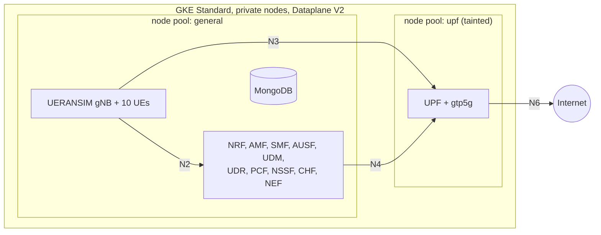

# Deploying a 5G Standalone Core on Google Kubernetes Engine Using Terraform and Helm

*Draft. Results are from the first live run on 2026-10-13 (`scripts/verify.sh`,
16/16 checks); re-run before publishing if versions change.*

---

## 1. Why run a 5G core on GKE?

A 5G Standalone (SA) core is a set of network functions (NFs) that talk to
each other over HTTP APIs: the Service-Based Architecture (SBA). AMF, SMF,
AUSF, UDM, UDR, PCF, NSSF and NRF are, in practice, microservices. That makes
Kubernetes a natural home for the control plane, and open-source cores such as
[free5GC](https://free5gc.org) ship Helm charts for it.

A managed cluster on Google Kubernetes Engine (GKE) adds things a lab usually
lacks: the whole environment is created from code in about 25 minutes,
destroyed when idle (it costs about $0.27 per hour with the defaults), and
identical on every run. That is useful for training, interoperability
experiments, CI for 5G applications, or simply learning how the pieces fit.

It is not free of friction. The user plane needs a Linux kernel module, the N2
interface uses SCTP, and a public cloud has opinions about networking and
security that a lab on a laptop does not. This article walks through a
Terraform + Helm template that deals with those points explicitly, and through
the decisions behind it.

The code is on GitHub: **[link]**.

## 2. Deployment architecture

- **free5GC v4.2.2** from the official
  [free5gc-helm](https://github.com/free5gc/free5gc-helm) charts: one AMF, one
  SMF, one UPF, and the supporting NFs.
- **UERANSIM** from the same repository: one gNB and ten UEs.
- **MongoDB** as the UDR's database, with authentication and a Persistent Disk.
- Two **node pools**: a general pool for everything except the UPF, and a
  small dedicated pool for the UPF and its kernel module.
- **Terraform** in two stages: `infra` (network, cluster, IAM, secret
  containers) and `platform` (everything inside the cluster).

Splitting Terraform into two stages is deliberate. The Kubernetes and Helm
providers need a running cluster to plan against. Putting cluster creation and
in-cluster resources in the same state leads to bootstrap problems on the
first apply and to failed destroys later. Two states, applied in order, avoid
both.

## 3. GKE networking versus 5G interfaces

This is where telecom and Kubernetes vocabularies meet, so let us map them.

In Kubernetes, the unit that gets an IP address is the **Pod**. Each NF runs in
one Pod with one interface, `eth0`, whose address comes from the cluster's Pod
range. A **Service** is a stable virtual IP and DNS name in front of one or more
Pods. A **headless** Service has no virtual IP: its DNS name resolves straight to
the Pod's address. A **NetworkPolicy** is a stateful firewall attached to Pods.

There are four address ranges, and only three of them are Kubernetes ranges:

| Range | Default | Role |
|---|---|---|
| Nodes | `10.10.0.0/24` | VM addresses |
| Pods | `10.20.0.0/20` | every NF, the gNB and the UE Pod |
| Services | `10.30.0.0/20` | virtual IPs for SBI, N2, MongoDB |
| **UE pool** | `10.60.0.0/16` | PDU-session addresses handed out by the SMF |

The UE pool is the one that confuses people. A UE address exists only on the
UE's tunnel interface and on the UPF. Between the gNB and the UPF it travels
inside GTP-U packets that are themselves addressed Pod-to-Pod. When it leaves
the UPF towards the internet, it is translated to the UPF's Pod address. The
cloud network never routes it, so it must not overlap the other ranges, but it
never needs to be declared in the VPC either.

The production-style way to deploy a 5G core on Kubernetes gives each 3GPP
interface its own network with Multus. On GKE that is a separate project, and
a lab does not need it. In this template every interface uses the Pod network:

- **N2 (NGAP over SCTP 38412)**: the gNB connects to a ClusterIP Service in front
  of the AMF. GKE supports SCTP only with **Dataplane V2** (its Cilium/eBPF
  datapath) on **Ubuntu** nodes and GKE 1.32.2 or later, and the Service port
  must equal the target port. All three are enforced in the Terraform code.
- **N3 (GTP-U over UDP 2152)**: gNB Pod to UPF Pod, directly. The SMF tells the
  gNB which address to use.
- **N4 (PFCP over UDP 8805)**: SMF to UPF Pod. The SMF resolves the UPF's
  headless Service once at start-up and uses the Pod IP as the PFCP node ID.
- **N6**: the UPF masquerades UE traffic to its own Pod address; Cloud NAT
  takes it to the internet.

NetworkPolicies start from *deny all ingress* and then allow only what the
interfaces need: N2 only from the gNB, N3 only from the gNB, MongoDB only from
the four NFs that use it.

## 4. Terraform infrastructure provisioning

All addressing lives in one YAML file. Before Terraform creates anything, a
small provider-less module checks every range: valid and canonical CIDR,
private address space, no overlap, and enough room. The capacity check uses
GKE's rule for per-node Pod blocks (64 Pods per node needs a `/25` per node, so
a `/20` holds 32 nodes) and counts one surge node per pool for upgrades. These
rules have offline unit tests.

The cluster itself:

- **Private nodes**, no external IPs; egress through **Cloud NAT**.
- **No public control-plane IP**. Administrators use GKE's **DNS-based endpoint**,
  where access is checked by IAM rather than by source IP. No bastion or VPN is
  needed.
- **Workload Identity Federation for GKE**, the GKE metadata server on every
  node, and a node service account with a single minimal role instead of the
  default Compute Engine account.
- **Shielded nodes**, and **Cloud KMS application-layer encryption** for
  Kubernetes Secrets.
- An **Artifact Registry remote repository** in front of Docker Hub, so private
  nodes are not subject to anonymous pull limits.

### The kernel module question

The free5GC UPF does not forward packets in user space. It programs
**gtp5g**, an out-of-tree Linux kernel module. Kubernetes cannot ship kernel
modules inside a container image, so the module has to exist on the node.

Three facts shape the solution:

1. Container-Optimized OS, GKE's default image, uses LoadPin to block
   out-of-tree modules. **Ubuntu** node images do not, and Ubuntu publishes
   kernel headers for its GKE kernels.
2. With **Secure Boot**, the Ubuntu kernel refuses unsigned modules, and gtp5g is
   unsigned.
3. Versions must match. free5GC v4.2.2 ships go-upf v1.2.10, which accepts
   gtp5g `>= 0.9.5` and `< 0.10.3` (the intersection of its README and the
   check compiled into the binary). The template pins **gtp5g 0.10.2**.

So the UPF gets a **dedicated, tainted node pool** with Secure Boot disabled and
the UPF's `ip_forward` sysctl allowed, while the general pool keeps Secure Boot
on. A DaemonSet on that pool runs a privileged *init* container that installs
the headers for the exact running kernel (and the compiler version the kernel
was built with), verifies the SHA-256 of the pinned gtp5g source, builds it and
loads it. Its long-running container is unprivileged and only reports
readiness while the right module version is loaded. New or replaced nodes get
the module automatically.

The UPF Pod has its own gate: an init container that refuses to start the UPF
unless `/sys/module/gtp5g/version` is in the accepted range. A UPF without a
working module never runs half-broken; it stays visibly in `Init`.

On GKE 1.36.4 with Ubuntu 24.04.4 nodes running kernel `6.8.0-1062-gke`, the
loader installed the matching `linux-headers` package from the Ubuntu archive,
compiled gtp5g 0.10.2 with gcc-13 (the kernel's own compiler) and loaded it in
a few minutes. The UPF's gate then saw version `0.10.2` and let it start.

## 5. Deploying free5GC and UERANSIM

The charts are used as published, pinned to a commit. When the pinned
templates offer no value for something, a small patch is applied
reproducibly, and its reason is recorded. There are six:

1. Single-UPF SMF template: the upstream README itself says to replace this
   file for single-UPF mode. The patch does exactly that.
2. N2 Service without a NodePort, so it can stay internal.
3. MongoDB credentials for NRF, UDR, PCF and CHF, which otherwise build an
   unauthenticated connection string.
4. An init-container hook on the UPF, for the gtp5g gate.
5. An extra-volume hook on the UEs, for per-UE credentials.
6. A fix for an upstream template bug (a duplicated readiness probe that strict
   Kubernetes schema validation rejects).

Everything else is values: PLMN, slice, DNN, TAC and UE pool, all derived from
the two YAML files and rendered through Terraform templates, so the AMF, SMF,
NSSF, AUSF, NRF, gNB and UEs cannot disagree. Every image is pinned by digest.
A few upstream defaults are deliberately changed: NAS ciphering prefers NEA2
over the default NEA0, the WebConsole and its default admin login are not
deployed, and an init container that ran `apt-get` as root on every MongoDB
start is removed.

## 6. Secure automated subscriber provisioning

Each UE needs a permanent key **K** and an operator key **OPc**. Those are real
secrets: whoever has them can authenticate as that SIM. The IMSIs, the PLMN and
the IP plan are *security-sensitive configuration*. They describe the network,
but they grant nothing, and they belong in version control.

So the secret path never touches Git or Terraform:

1. A bootstrap script generates two MongoDB passwords and one random K/OPc
   pair per IMSI with `openssl rand`, and pipes them to **Google Secret Manager**
   on standard input. Nothing is written to disk or passed as a command-line
   argument.
2. Terraform creates only the empty secrets and the IAM bindings. Since it never
   reads a value, plans and state cannot contain one. (Marking a variable
   `sensitive` would only hide it from the console; it would still be in state.)
3. **GKE Secret Manager sync** copies the secrets into Kubernetes Secrets. It
   authenticates as a Kubernetes ServiceAccount through **Workload Identity
   Federation**; each namespace's account may read only the secrets it needs.
4. A **Kubernetes Job** writes the subscribers into MongoDB in exactly the
   document format free5GC's WebConsole uses, checked against its source code.
   Writes are idempotent upserts that never reset fields the network updates
   itself: the UDM advances the sequence number on every authentication, so
   re-running provisioning must not roll it back. The Job checks that the IMSIs
   in the secret match the configuration and never deletes anything.
5. The UE Pod mounts the same credentials and starts one `nr-ue` per
   subscriber, each from a config built in memory.

The provisioner was tested against a real, authenticated MongoDB: first run,
idempotent re-run, preservation of network-owned fields, rejection of bad
input without echoing it, and no secret in any output.

## 7. Testing 10 simulated UEs

Testing is split into three tiers:

1. **Static** (every pull request, no cloud): Terraform validation and unit
   tests, chart rendering with the real values, and 300+ assertions on the
   rendered manifests (digest pins, no exposed Services, no secret material in
   values, MongoDB authentication wiring, consistent Service names across the
   two charts), plus ShellCheck, Gitleaks, Trivy and Checkov.
2. **Deployment health**: nodes, gtp5g version on the UPF node, Pods, synced
   Secrets, authenticated MongoDB, and the exact subscriber set.
3. **5G functional**: gNB NG Setup over SCTP, registration of all ten UEs,
   one PDU session each, and a ping through each UE's tunnel interface, which
   exercises N3, the UPF and N6.

Results of the first live run (16/16 checks):

| Check | Result |
|---|---|
| NG Setup over SCTP | successful |
| Registration | 10/10 UEs `RM-REGISTERED` |
| PDU sessions | 10/10 `PS-ACTIVE`, addresses 10.60.0.1–10.60.0.10 |
| User plane | 10/10 UEs ping 8.8.8.8 through their tunnel interface, 0% loss |

In the infrastructure stage the GKE cluster took 8 minutes and each node
pool about 2 minutes (Terraform's own timings).

The first live run also found five bugs that no offline test could have
caught. The most instructive: the upstream chart mounts MongoDB's disk directly
on its data directory. A brand-new Persistent Disk contains `lost+found`, so
the Bitnami image concluded the database already existed, skipped creating
users, and still enabled authentication. Every NF failed to authenticate. The
fix is one line of values; finding it took reading the image's startup log.

## 8. Lessons learned and limitations

- **Read the chart, not the README of the README.** Single-UPF mode,
  MongoDB authentication and the N2 Service type all looked like values at
  first glance. Only reading the templates showed which needed a patch.
- **The kernel is the platform.** The UPF's dependency on a kernel module
  matters more than any Kubernetes detail. Pin the module, gate the UPF on it,
  and confine the privileges it needs to one node pool. Managed node
  auto-upgrades bring new kernels: the loader rebuilds automatically, but only
  if Ubuntu has published headers for that kernel.
- **Secrets are a data-flow problem.** Keeping K/OPc out of Terraform state,
  Helm values, ConfigMaps, process lists and logs took deliberate design at
  each hop. Encrypting state afterwards would not have achieved it.
- **Limitations.** This is a lab: one zone, one UPF, plain-HTTP SBI inside the
  cluster, privileged UPF components, a UPF node pool without Secure Boot,
  upstream test keys for SUCI concealment (unused, since UEs use the null
  scheme), and lab-grade NFs. It is not a production design, and it must not
  carry real subscribers.

## 9. GitHub repository and next steps

The repository contains the Terraform stages, Helm values templates and
patches, the gtp5g loader, the provisioner, the three test tiers, CI with
pinned actions, and an optional manual deployment workflow that authenticates
with GitHub OIDC and requires an approved environment.

Possible next steps:

- Multus or GKE multi-networking for dedicated N2/N3/N4/N6 interfaces.
- HTTPS on the SBI with generated certificates, and NRF OAuth.
- SUCI concealment with freshly generated home-network keys.
- Egress NetworkPolicies and Binary Authorization.
- A second UPF (ULCL) and multiple slices.
- Replacing the frozen Bitnami MongoDB image.

**[Repository link]** · **[Author]**
