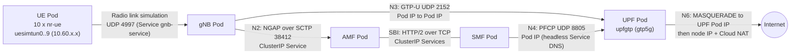

# Networking

## 1. The address plan

All ranges come from [`config/network.yaml`](../config/network.yaml). The
defaults are illustrative, not mandatory.

| Range | Default | Lives where | Used for |
|---|---|---|---|
| `node_cidr` | `10.10.0.0/24` | VPC subnet (primary range) | Node VM NICs |
| `pod_cidr` | `10.20.0.0/20` | VPC subnet (secondary range `pods`) | Every Pod IP, including AMF, SMF, UPF, gNB, UEs |
| `service_cidr` | `10.30.0.0/20` | VPC subnet (secondary range `services`) | ClusterIP Services (SBI, MongoDB, N2) |
| `ue_cidr` | `10.60.0.0/16` | **Nowhere in the VPC** | UE PDU-session addresses, allocated by the SMF, routed only inside GTP-U tunnels and the UPF |

**The UE pool is not a Kubernetes range.** A UE address (e.g. `10.60.0.3`)
exists only on the UE's `uesimtunN` interface and on the UPF's `upfgtp`
device. Between gNB and UPF it travels *inside* GTP-U packets addressed
Pod-to-Pod. When it leaves the UPF towards the internet (N6) it is masqueraded
to the UPF Pod's IP. The VPC never routes `10.60.0.0/16`, which is why it must
not overlap any VPC range, but it never needs to be added to one.

### Validation (before anything is created)

`terraform/modules/config` fails the plan with a precise message unless:

- every range is a canonical IPv4 CIDR (`10.20.5.0/16` is rejected: host bits set);
- every range is in RFC 1918 or RFC 6598 (`100.64.0.0/10`) space;
- no two ranges overlap (including `ue_cidr`, and any `extra_reserved_cidrs`
  such as an on-prem range);
- `node_cidr` is `/29` or larger; `service_cidr` is between `/16` and `/28`;
- the ranges have room for the node pools *including one surge node per pool
  during upgrades*:
  - per-node Pod block = `/M` with `M = 31 - ceil(log2(max_pods_per_node))`
    (64 Pods/node gives `/25`), so `pod_cidr` holds `2^(M - prefix)` nodes
    (`/20` holds 32);
  - `node_cidr` holds `2^(32 - prefix) - 4` nodes (first two and last two
    addresses are reserved);
- `ue_cidr` has room for every subscriber.

These rules are unit-tested offline (`terraform test`, 16 cases).

## 2. 5G interfaces without Multus

free5GC's charts support Multus (dedicated N2/N3/N4/N6 interfaces with static
IPs). GKE Dataplane V2 does not support Multus with ipvlan/macvlan out of the
box, and a lab does not need it. In this design **every interface runs over the
standard Pod network**:

| Interface | Protocol | How it is wired here | Notes |
|---|---|---|---|
| **N2** (gNB to AMF) | NGAP / SCTP 38412 | gNB connects to the AMF's ClusterIP Service `free5gc-free5gc-amf-amf-n2.free5gc.svc.cluster.local` | SCTP on GKE requires Dataplane V2 + Ubuntu nodes; Service `port` = `targetPort` (Cilium does not rewrite SCTP ports). Patch 0002 keeps it ClusterIP |
| **N3** (gNB to UPF) | GTP-U / UDP 2152 | Direct Pod-to-Pod. The SMF tells the gNB the UPF's N3 address (the UPF Pod IP) in the PDU Session Resource Setup | GTP-U adds 36-byte headers (IP, UDP, GTP + extension); see MTU below |
| **N4** (SMF to UPF) | PFCP / UDP 8805 | The SMF resolves the UPF's headless Service to its Pod IP at start-up (patch 0001) and uses it as the PFCP node ID | If the UPF Pod is rescheduled with a new IP, restart the SMF (see troubleshooting) |
| **N6** (UPF to data network) | IP | The UPF decapsulates, then `iptables MASQUERADE` rewrites `10.60.0.0/16` to its Pod IP on `eth0`. GKE then SNATs to the node IP, and Cloud NAT to a public IP | Return traffic follows the reverse NAT chain |
| **SBI** | HTTP/2 (plain HTTP in this lab) | ClusterIP Services, discovered through the NRF | See security.md about TLS |

### What a telecom engineer should map

- A **Pod** is the unit that gets an IP. Each NF is one Pod with one interface
  (`eth0`) from `pod_cidr`.
- A **ClusterIP Service** is a stable virtual IP and DNS name in front of Pods,
  load-balanced by the dataplane (Cilium eBPF). N2 and the SBI use Services.
- A **headless Service** has no virtual IP: its DNS name returns the Pod IP
  directly. PFCP uses it because the node ID must be the UPF's real address.
- **NetworkPolicy** is a per-Pod stateful firewall enforced by Dataplane V2.
  Here: default-deny ingress, then explicit allows for SBI, N2 (SCTP, from the
  gNB only), N3 (from the gNB only), MongoDB (from four NFs and the provisioner
  only) and radio-link simulation.

### MTU

GKE VPC MTU defaults to 1460 bytes, and Pod interfaces inherit it. GTP-U
encapsulation adds about 36 bytes, so a full-size UE packet does not fit in one
N3 packet. UERANSIM and the gtp5g module fragment as needed, which is
acceptable for functional tests. For throughput tests, lower the UE-side MTU or
raise the VPC MTU (up to 8896) in `modules/network`.

## 3. Optional advanced addressing (future)

`config/network.yaml` reserves `interfaces.multus_enabled` (currently rejected
if `true`). A future Multus design would add, per interface, a subnet and static
IPs for AMF (N2), SMF (N4), UPF (N3/N4/N6) and gNB (N2/N3), mapped onto the
chart's existing `global.*.multus` values. On GKE this needs multi-network
support (GKE multi-networking with additional node networks), which is a
separate design.

## 4. Firewalls and exposure

- Nodes have no external IPs. Egress uses Cloud NAT. Google APIs use Private
  Google Access.
- The only VPC firewall rule added is an explicit deny-all ingress baseline.
  GKE adds its own higher-priority rules for control-plane-to-node and
  intra-cluster traffic.
- No Service is of type `NodePort` or `LoadBalancer`, and there is no Ingress.
  MongoDB, AMF, UPF and the (disabled) WebConsole are not reachable from
  outside the cluster.
- The control plane has no public IP endpoint. Administrators use the
  DNS-based endpoint, authorised by IAM (`container.clusters.connect`).
