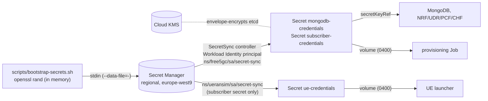

# Security design

Scope: a **lab** deployment of an open-source 5G core. The goal is to avoid
the common mistakes (keys in Git, secrets in state, public databases, default
credentials) and to state the remaining risks honestly. free5GC itself is not
a hardened, production-grade core.

## 1. Secrets versus security-sensitive configuration

| Category | Examples here | Where it lives | Why |
|---|---|---|---|
| **Secret**: possession grants access or impersonation | MongoDB root and app passwords; per-subscriber **K** and **OPc** | Generated at bootstrap → Google Secret Manager → Kubernetes Secrets (in-cluster only) | Leaking K/OPc lets anyone authenticate as that SIM; leaking DB passwords exposes all subscriber keys |
| **Security-sensitive configuration**: reveals or shapes the attack surface, but grants nothing | IMSIs, PLMN (MCC/MNC), S-NSSAI, DNN, IP ranges, project ID, cluster endpoint name, AMF field `8000`, initial SQN | Git (`config/*.yaml`), Terraform state, ConfigMaps | Needed for reproducibility and review. IMSIs are identifiers, not credentials (5G-AKA requires K) |

## 2. Secret lifecycle

Properties, each enforced by code:

- **Never in Terraform.** Terraform declares secret containers, IAM bindings and
  `SecretSync` objects (names only). No resource or data source reads a secret
  value, so plans and state contain none. (Marking variables `sensitive` would
  *not* keep values out of state; that is why values never enter Terraform.)
- **Never on disk or in argv on the admin machine.** Values exist in shell
  variables and are piped to `gcloud ... --data-file=-`.
- **Never in Helm values, ConfigMaps or manifests.** MongoDB users read
  `secretKeyRef`s; the NF URI is composed by Kubernetes `$(VAR)` expansion and
  rendered by `awk` from `ENVIRON` into a memory-backed volume (patch 0003); UE
  configs are built from placeholders with bash builtins into a memory-backed
  volume. `tests/check_rendered.py` fails if any rendered values file or
  ConfigMap contains a 128-bit hex value or a credentialed MongoDB URI.
- **Never in process listings.** Verified by `tests/test_provisioner_local.sh`
  and the UE launcher test; the provisioner and verify scripts never print
  driver messages that could echo a URI.
- **Never in logs.** The provisioner prints counts and IMSIs only; malformed
  credential lines are reported by line number, not content.
- **Least privilege.** Each namespace's `secret-sync` ServiceAccount is granted
  `roles/secretmanager.secretAccessor` on specific secrets only (UERANSIM cannot
  read the MongoDB passwords). The MongoDB app user has `readWrite` on the
  `free5gc` database only.
- **Encrypted at rest.** Secret Manager (Google-managed keys); Kubernetes
  Secrets in etcd are additionally envelope-encrypted with a Cloud KMS key
  (application-layer secrets encryption, rotated every 90 days); the MongoDB
  Persistent Disk is encrypted by Google by default.
- **Rotation.** `scripts/bootstrap-secrets.sh --rotate-subscribers` adds a new
  secret version with fresh K/OPc; `scripts/deploy.sh --reprovision` re-runs the
  Job (updates keys, preserves SQN) and restarts the UEs. MongoDB password
  rotation is **not** automated (the Bitnami chart only sets passwords at first
  initialisation).

## 3. Terraform state

- Contains no secret values by design (see above). It does contain project ID,
  network layout, resource names, the cluster DNS endpoint, rendered Helm values
  and Kubernetes manifests.
- Default: local state files, git-ignored. Shared use: a **private** GCS bucket
  with uniform bucket-level access, public access prevention, object versioning
  and access limited to the administrators (`backend.tf.example`).
- CI (`deploy.yml`) always uses the GCS backend.

## 4. Identity and access

| Principal | Authentication | Permissions |
|---|---|---|
| Administrator (Terraform, scripts) | Application Default Credentials (`gcloud auth application-default login`) | See [deployment.md](deployment.md#iam) |
| GitHub Actions (optional) | OIDC → Workload Identity Federation → impersonated deployer SA | Same as administrator; gated by a protected Environment |
| GKE nodes | Dedicated SA `<prefix>-gke-nodes` | `roles/container.defaultNodeServiceAccount`; `artifactregistry.reader` on the proxy repo only |
| Secret sync (per namespace) | Workload Identity Federation for GKE (principal identifier, no Google SA) | `secretAccessor` on named secrets |
| Workload Pods | GKE metadata server (`GKE_METADATA`); no node credentials visible | None in GCP |
| Kubernetes ServiceAccounts | `automountServiceAccountToken: false` on our ServiceAccounts, Job and DaemonSet | No RBAC granted; no workload needs the Kubernetes API |

No service-account key is created, required or accepted anywhere.

## 5. Network exposure

See [networking.md](networking.md#4-firewalls-and-exposure): private nodes, no
public control-plane IP, no NodePort/LoadBalancer/Ingress, default-deny
ingress NetworkPolicies in all three namespaces with explicit allows.

## 6. Upstream defaults replaced or disabled

| Upstream default | Action |
|---|---|
| MongoDB without authentication | Enabled: root + `free5gc` app user from Secret Manager |
| WebConsole with `admin`/`free5gc` | Not deployed (`deployWebui: false`); subscribers come from the Job |
| AMF NAS ciphering `NEA0` only | `cipheringOrder: [NEA2, NEA0]`, `integrityOrder: [NIA2]` |
| UE key `8baf473f…` / OPc `8e27b6af…` in chart values | Replaced by random per-UE K/OPc; a check fails if the default appears |
| MongoDB init container `apt-get install tini` from unpinned `debian:12-slim` as root | Removed (Bitnami entrypoint used) |
| Unpinned images (`:latest`, tags) | Every installed image pinned by digest; checked in CI |
| microk8s hostPath PersistentVolume | Removed; CSI `standard-rwo` |
| AMF N2 as NodePort 31412 | ClusterIP (patch 0002) |
| Bitnami NetworkPolicy | Replaced by explicit policies |

## 7. Residual risks (accepted for a lab)

1. **Kubernetes Secrets are readable by cluster admins** and by anything that can
   exec into the consuming Pods. Values also exist in memory-backed volumes
   inside the UE and NF Pods. Mitigations: KMS envelope encryption, no RBAC
   granted to workloads, private cluster.
2. **Privileged components.** The gtp5g loader's init container is privileged
   (kernel module loading). The UPF has `NET_ADMIN` and the `ip_forward` sysctl;
   UEs have `NET_ADMIN` and create TUN devices. These namespaces therefore
   enforce Pod Security `privileged` (with `baseline` warn/audit). The UPF node
   pool runs **without Secure Boot** so the unsigned module can load. All three
   are confined to dedicated namespaces and, for the module, a dedicated tainted
   node pool.
3. **Kernel module from source on the node.** gtp5g is fetched from GitHub,
   verified by SHA-256 and compiled at node start; kernel headers come from the
   Ubuntu archive over Cloud NAT. A compromised Ubuntu mirror or a gtp5g bug runs
   in kernel space. The UPF itself is lab-grade software.
4. **SBI is plain HTTP, NRF OAuth is off.** Upstream default; traffic stays
   inside the cluster and is restricted by NetworkPolicy. Turning on HTTPS would
   require replacing the chart's bundled certificates (below).
5. **Upstream TLS material.** The umbrella chart renders Secrets from
   `cert/*.key` shipped in the public upstream repository. These keys are
   publicly known. They are mounted but unused while SBI is HTTP, and must
   never be relied on.
6. **UDM SUCI private keys are the public TS 33.501 Annex C.4 test vectors**
   (upstream values). UEs use the null scheme (SUPI not concealed), so these keys
   are not exercised; enabling SUCI concealment would require generating new
   home-network keys and delivering them like the other secrets.
7. **Unrestricted egress.** NFs need DNS; the UPF forwards UE traffic to the
   internet. Egress NetworkPolicies are a possible hardening step.
8. **Bitnami "legacy" MongoDB image.** `bitnamilegacy/*` images no longer receive
   updates. It is pinned by digest and only reachable from four NFs and the
   provisioner. Replacing it with an actively maintained image is recommended
   before any longer-lived use.
9. **Docker Hub images** (free5GC, UERANSIM, `towards5gs/sctp_test`) are
   community-built. Digests make them immutable, not trustworthy; no signature
   verification (Binary Authorization) is configured.
10. **Lab-grade 5G core.** free5GC NFs have not been hardened or audited for
    hostile networks. Do not connect real RAN equipment or real subscribers.

## 8. Scanning performed

| Tool | Scope | Result (2026-10-13) |
|---|---|---|
| Gitleaks 8.30.1 | Working tree (CI: full history) | No leaks. One false positive (Secret key-name mapping) annotated inline |
| Trivy 0.74.0 config | Terraform | No HIGH/CRITICAL. 4 LOW/MEDIUM accepted with justification (`.trivyignore`) |
| Checkov 3.3.13 | Terraform | 52 passed, 0 failed, 9 skipped with inline justifications |
| ShellCheck 0.11.0 | All scripts, plus the rendered UE launcher | Clean |
| kubeconform 0.8.0 (`-strict`, Kubernetes 1.33 schemas) | Rendered manifests | 75/75 valid (after patch 0006 fixed an upstream duplicate key) |
| actionlint 1.7.12 | Workflows | Clean |
| `tests/check_rendered.py` | Rendered manifests | 300+ checks pass (digest pins, no exposure, no secrets in values/ConfigMaps, MongoDB auth wiring, UPF gate, cross-chart names) |

## 9. Reporting

This is a template repository. Please report security issues privately to the
repository owner instead of opening a public issue.
